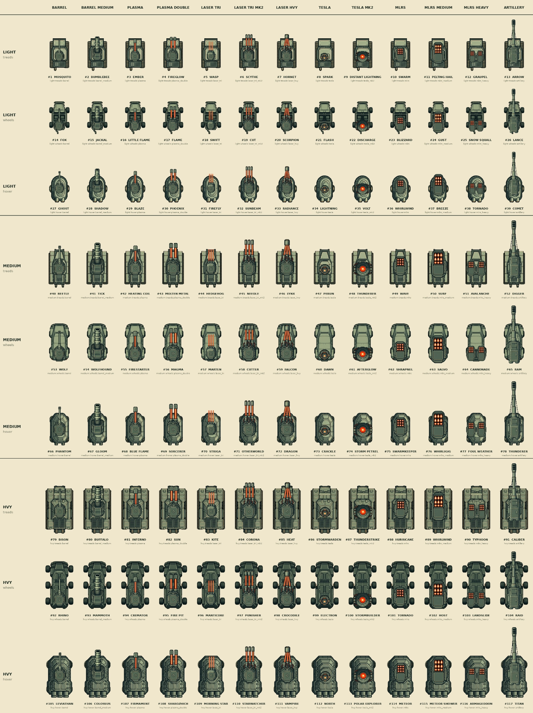

# Armored Vehicle Catalogue

*Ministry of Defense · Directorate of Armored Standardization · Public Reference Copy*

**117 documented configurations. One Motherplant.**

The current visual catalogue combines **three hull classes** (Light, Medium, Heavy), **three drive types** (treads, wheels, hover) and **thirteen weapon configurations**. Every vehicle has its own designation in the reference chart below.

[**Open the complete catalogue at full resolution**](assets/vehicles/armored-vehicle-catalogue.webp)

!!! note "Development reference"
    This is a **work-in-progress visual and naming catalogue**, not a finalized statement of combat balance, vehicle availability, upgrade progression, or production lore. The designs and designations may change during development.

## Armament columns

Barrel · Barrel Medium · Plasma · Plasma Double · Laser Tri · Laser Tri Mk2 · Laser Heavy · Tesla · Tesla Mk2 · MLRS · MLRS Medium · MLRS Heavy · Artillery

---

**MINISTRY NOTICE:** Vehicle identification is mandatory. Unauthorized assembly is not.
