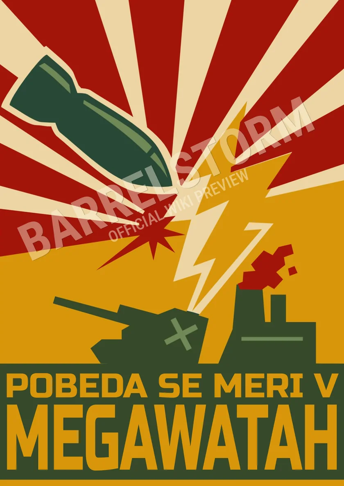

# Propaganda Gallery

*Department of Cultural Reprocessing · Public Display Copies*

!!! success "Eight prints approved for public circulation"
    These are **reduced-resolution, watermarked archive previews**. They are propaganda artifacts from the fictional world of *BarrelStorm*, not real-world political endorsements. The clean, high-resolution masters are intentionally not hosted in this repository.

  <figure class="bs-poster-card">
    
    <figcaption><strong>Tank Battalion Needs You</strong>Ministry of Defense · Recruitment</figcaption>
  </figure>
  <figure class="bs-poster-card">
    
    <figcaption><strong>Steel Is Loyalty</strong>Ministry of Defense · Armored Corps</figcaption>
  </figure>
  <figure class="bs-poster-card">
    
    <figcaption><strong>Mothercore Provides Heat</strong>Ministry of Maternal Welfare · Heating</figcaption>
  </figure>
  <figure class="bs-poster-card">
    
    <figcaption><strong>One Reactor, One People</strong>Ministry of Public Clarity · Unity</figcaption>
  </figure>
  <figure class="bs-poster-card">
    
    <figcaption><strong>Glory to Logistics</strong>Ministry of Production · Supply</figcaption>
  </figure>
  <figure class="bs-poster-card">
    
    <figcaption><strong>Progress Calls</strong>Ministry of Progress · Public Health</figcaption>
  </figure>
  <figure class="bs-poster-card">
    
    <figcaption><strong>Report Radiation Leaks</strong>Ministry of Safety · Public Notices</figcaption>
  </figure>
  <figure class="bs-poster-card">
    
    <figcaption><strong>Victory in Megawatts</strong>Ministry of Production · Energy</figcaption>
  </figure>

## Public archive policy

This page displays **web-resolution previews only**. The original print-resolution posters are kept separately for the game and official promotional use. Watermarks discourage casual reuse; they do not guarantee protection against copying.

**OFFICIAL NOTICE:** Cultural appreciation is encouraged. Unauthorized edits to official history are not.
